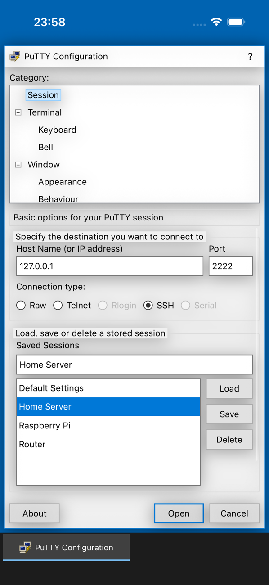
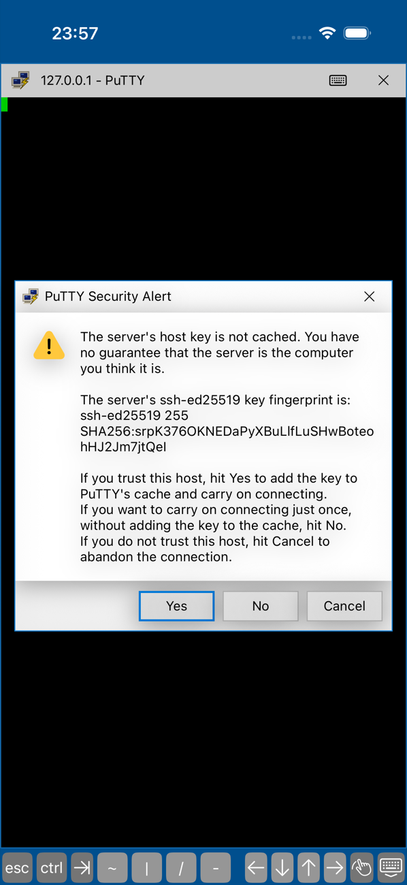
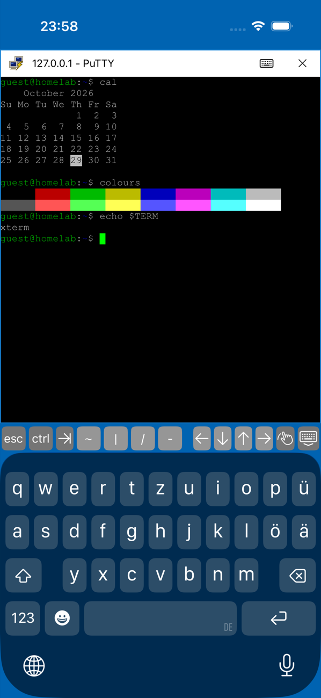

# PuTTY for iOS

An SSH, Telnet and Raw client for iPhone and iPad that looks and works like PuTTY on Windows, from the "PuTTY Configuration" window down to the "PuTTY Security Alert".

Website: **[iosxputty.cc](https://www.iosxputty.cc)**

This is an unofficial, independent project. It is not affiliated with PuTTY or its authors; it is modelled on PuTTY by Simon Tatham.

<p>
  
  
  
</p>

## Download

**[PuTTY-iOS-unsigned.ipa](https://github.com/Oxapayy/putty-ios/releases/latest/download/PuTTY-iOS-unsigned.ipa)** (iOS 17 or later, unsigned)

The IPA is not signed. Install it with one of:

- **Sideloadly** or **AltStore**: they sign it with your Apple ID (free accounts need a refresh every 7 days).
- **TrollStore**: installs it permanently on supported iOS versions.

## Features

- **The PuTTY Configuration window**: category tree, host name and port, connection type, saved sessions with Load / Save / Delete, close window on exit.
- **SSH** with PuTTY's login flow: `login as:`, `user@host's password:`, "Access denied", host key verification with SHA256 fingerprints and a host key cache.
- **Public key login** with OpenSSH keys and PuTTY `.ppk` files (Ed25519, RSA; passphrase protected keys are asked for at login).
- **Telnet** (NAWS, terminal type, echo negotiation) and **Raw** TCP.
- **A full xterm terminal** with PuTTY's default colours and green cursor, Courier New, scrollback, pinch to zoom, and a key bar with Esc, Ctrl, Tab and arrows.
- **The PuTTY window menu**: New Session, Duplicate, Restart, Saved Sessions, Change Settings, Copy All to Clipboard, Paste, Clear Scrollback, Reset Terminal.
- **Several sessions at once**, switched from a taskbar.
- **Settings that do something**: local echo, implicit CR/LF, Backspace as ^H or ^?, bell (vibrate or flash), cursor shape, font, colour schemes, keepalives, TCP_NODELAY, auto-login username, terminal type.

## Privacy

Nothing is logged. There is no event log, no session logging and no analytics; the SSH libraries' logging is routed to a no-op handler. Passwords and passphrases are never stored. Private keys are copied into the iOS Keychain (or, on sideloaded builds without a keychain entitlement, into a file with complete data protection). Saved sessions hold only settings.

## Limitations

- RSA **user keys** are signed with `ssh-rsa` (SHA-1), which OpenSSH 8.8+ rejects by default. Use Ed25519 keys. RSA host keys are fine.
- `keyboard-interactive` authentication is not supported; servers must allow `password` or `publickey`.
- Encrypted `.ppk` version 3 files (Argon2) are not supported; version 2 and unencrypted version 3 are.
- Rlogin and Serial are shown but disabled: iOS has neither privileged ports nor serial lines.
- iOS suspends background apps; connections survive a short app switch (about 30 seconds), not longer.

## Building

Requirements: Xcode 26, [XcodeGen](https://github.com/yonaskolb/XcodeGen).

```bash
xcodegen generate
xcodebuild build -project PuTTY.xcodeproj -scheme PuTTY -configuration Release \
  -destination 'generic/platform=iOS' -derivedDataPath build/dd -skipPackagePluginValidation \
  CODE_SIGNING_ALLOWED=NO
mkdir -p Payload && cp -R build/dd/Build/Products/Release-iphoneos/PuTTY.app Payload/ && zip -qry PuTTY-iOS-unsigned.ipa Payload
```

### Tests

`scripts/run-uitests.sh` runs end-to-end UI tests in the iOS Simulator against a local OpenSSH server: host key alert and fingerprint, `login as:`, wrong password, encrypted key with wrong and right passphrase, shell commands, and closing on a clean exit. See the script header for its arguments.

## Built with

- [SwiftTerm](https://github.com/migueldeicaza/SwiftTerm) for terminal emulation
- [Citadel](https://github.com/orlandos-nl/Citadel) and SwiftNIO SSH for SSH

## License

MIT, see [LICENSE](LICENSE).
